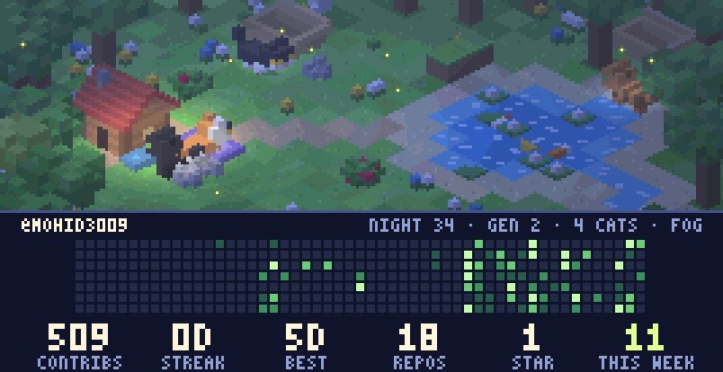

  

<!--
CATOPIA is re-rendered hourly (one simulated night per hour) by .github/workflows/update-catopia.yml from my
GitHub contribution data. Run locally: pip install -r requirements.txt && python run.py --offline
-->
